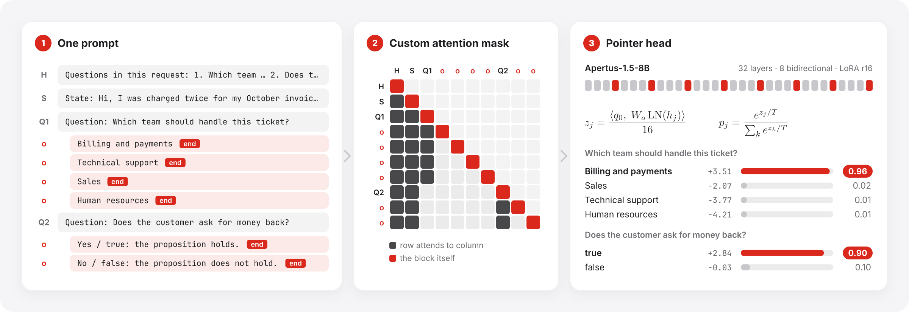

<h1 align="center">votum</h1>

<p align="center"><b>A decision model on a fully open LLM backbone.</b></p>

<p align="center">
  <a href="https://huggingface.co/votum-ai/Votum-8B"></a>
  <a href="https://huggingface.co/datasets/votum-ai/Votum-Pool"></a>
  
  
</p>

<p align="center">
  <a href="#quickstart">Quickstart</a> ·
  <a href="#request-and-response">Request and response</a> ·
  <a href="#images">Images</a> ·
  <a href="#run-it-as-a-server">Server</a> ·
  <a href="#speed">Speed</a> ·
  <a href="#fine-tuning">Fine-tuning</a> ·
  <a href="#documentation">Documentation</a>
</p>

**Votum** turns  [Apertus-1.5-8B](https://huggingface.co/swiss-ai/Apertus-v1.5-8B)
into a decision model. You give it some context (an email, a document, a JSON record, a photo), a question about it and
the possible answers. It gives back a probability for each answer.

It does not write text. It reads the prompt once and scores the answers, so a short decision takes under 100 ms,
the result is always one of your options, and the probabilities always sum to one.

<picture><source media="(prefers-color-scheme: dark)" srcset="assets/examples_dark.png"></picture>

The open weights and the open dataset are on Hugging Face: [Votum-8B](https://huggingface.co/votum-ai/Votum-8B),
[Votum-8B-FP8](https://huggingface.co/votum-ai/Votum-8B-FP8) (smaller) and the training data,
[Votum-Pool](https://huggingface.co/datasets/votum-ai/Votum-Pool). This repository holds the code.

## Quickstart

Requirements: Python 3.11 or newer and an NVIDIA GPU.

| GPU memory | Model | Notes |
|---|---|---|
| 24 GB or more | [votum-ai/Votum-8B](https://huggingface.co/votum-ai/Votum-8B) | the full model, a 16 GB download |
| 16 GB | [votum-ai/Votum-8B-FP8](https://huggingface.co/votum-ai/Votum-8B-FP8) | FP8-quantized weights, a 9 GB download; it gives the same answer as the full model 96 to 99 % of the time |

**1. Install the package.**

```bash
pip install votum
```

**2. Get access to the model.** The model is gated. Signed in to Hugging Face, accept the Apertus Acceptable Use
Policy on [votum-ai/Votum-8B](https://huggingface.co/votum-ai/Votum-8B); access is granted at once. Then connect your
machine to your account with an access token ([huggingface.co/settings/tokens](https://huggingface.co/settings/tokens),
read access is enough):

```bash
hf auth login
```

**3. Run a request.** The email from the figure above, with its three questions:

```python
from votum import Votum

# On a 16 GB GPU, use "votum-ai/Votum-8B-FP8" instead.
vm = Votum.from_pretrained("votum-ai/Votum-8B")

request = {
    "state": "Hi, I was charged twice for my October invoice (INV-4411). Could you refund one of the two payments?",
    "questions": {
        "team": {
            "type": "choice",
            "instructions": "Which team should handle this ticket?",
            "criteria": {
                "billing": "Billing and payments",
                "tech": "Technical support",
                "sales": "Sales",
                "hr": "Human resources",
            },
        },
        "refund": {
            "type": "noul",
            "instructions": "Does the customer ask for money back?",
        },
        "urgency": {
            "type": "score",
            "instructions": "How urgent is this ticket?",
            "criteria": ["low", "medium", "high"],
        },
    },
}

out = vm.decide(request)

print(out["answers"])
```

```python
{
    "team": {
        "type": "choice",
        "choice": "billing",
        "confidence": 0.9619,
        "probabilities": {
            "billing": 0.9619,
            "tech": 0.0079,
            "sales": 0.0243,
            "hr": 0.0059,
        },
    },
    "refund": {
        "type": "noul",
        "noul": 0.8994,
    },
    "urgency": {
        "type": "score",
        "score": 0.9621,
        "confidence": 0.4133,
        "legend": {
            "0": "low",
            "1": "medium",
            "2": "high",
        },
        "probabilities": {
            "0": 0.3123,
            "1": 0.4133,
            "2": 0.2744,
        },
    },
}
```

Votum returns probabilities, not just a label, so high-confidence answers can be acted on and the rest escalated.

## Request and response

A request has two parts:

- **`state`**: the context to decide on. A string, or any JSON object.
- **`questions`**: up to 8 questions about that state, keyed by an id. They are answered together.

Every question has `instructions` (the question text), a `type` and, depending on the type, `criteria`:

| `type` | Use | `criteria` |
|---|---|---|
| `choice` | one of several options | the options: `{id: description}`, or a list of ids |
| `noul` | a yes/no question | optional: `{"true": description, "false": description}` |
| `score` | a rating on a scale | the levels, lowest first |

The answer to a question holds its `type` and these fields:

| Field | Returned for | Value |
|---|---|---|
| `choice` | `choice` | id of the most likely option |
| `noul` | `noul` | probability that the answer is yes |
| `score` | `score` | expected level, counting from 0 (0.96 is close to level 1, the second one) |
| `confidence` | `choice`, `score` | probability of the most likely option or level |
| `probabilities` | `choice`, `score` | probability of every option or level |
| `legend` | `score` | level index to level text |

Notes:

- **Option descriptions.** `{"billing": "Billing and payments"}` works better than a bare `"billing"`.
- **Languages.** Votum was built for English, German, French and Italian; instructions can be in the language of the
  state or in English.
- **Context.** The state, one question and its options must fit in 8,192 tokens. A longer request is refused with an
  error, never truncated.
- **Questions.** The architecture puts no limit on the number of questions per request: each question is scored in
  its own pass over the shared state, so only a single question's prompt has to fit. The server accepts 64 per
  request by default (`VOTUM_MAX_QUESTIONS`).

The request format (`noul`, `instructions`, `criteria`) is that of [Jev and Jeff](#acknowledgements), so their clients
work unchanged.

## Images

A state can hold images. Put one anywhere in it as `{"image": ...}`:

```python
request = {
    "state": {
        "photo": {
            "image": "wreck.jpg",
        },
        "line": "mountain branch, km 41",
    },
    "questions": {
        "incident": {
            "type": "choice",
            "instructions": "What happened?",
            "criteria": {
                "derailment": "A locomotive derailed",
                "collision": "Two trains collided",
                "fire": "A fire",
                "none": "Nothing, normal operation",
            },
        },
    },
}

out = vm.decide(request)
```

In Python, the image can be a file path (as here), raw bytes, a PIL image or a base64 string. Over HTTP it must be
base64-encoded, either plain or as a data URL (`"data:image/png;base64,..."`): the server never opens files or URLs
named in a request.

This needs two more packages: `pip install "votum[vision]"`.

Image support is a preview. Votum-8B was never trained on images: everyday photos work well, text inside scanned
documents does not yet. [docs/images.md](docs/images.md) has more examples, the measured accuracy and the settings.

## Run it as a server

`votum serve` starts an HTTP server built on vLLM, which batches concurrent requests:

```bash
pip install "votum[vllm]"
votum serve --model votum-ai/Votum-8B --port 8011
```

```bash
curl -s localhost:8011/v1/systemone -H 'content-type: application/json' -d '{
  "state": "The printer on floor 3 is jammed again.",
  "questions": {
    "team": {
      "type": "choice",
      "instructions": "Which team?",
      "criteria": {
        "it": "IT support",
        "fac": "Facilities"
      }
    }
  }
}'
```

The endpoint takes the same request as `vm.decide` and returns the same answers. It follows Jev's System One API, so
Jev clients work against it. [docs/serving.md](docs/serving.md) covers the API key, memory and the other settings.

## Speed

Measured on one NVIDIA RTX 4090 (24 GB) with the full Votum-8B, running as a server:

| Request | Prompt tokens | Latency | Decisions/s, many requests at once |
|---|---:|---:|---:|
| 1 question about a short text | ~450 | ~40 ms | 23.5 |
| 1 question about a long document | ~3,000 | ~320 ms | 3.1 |
| 8 questions about a long document | ~3,300 | ~470 ms | 15.8 |

Asking several questions about the same state at once is cheaper than asking them one by one, because the state is
read only once. With eight questions per request, the long document gives 5 times as many decisions per second as
with one.

For comparison, Apertus-1.5-8B generating the choice and its probabilities as structured output takes about 1.1 s for
the short text, against about 40 ms. [docs/benchmarks.md](docs/benchmarks.md) says exactly how each number was measured.

## How good are the answers?

Accuracy on public test sets outside the training data:

| Task | Accuracy | Accuracy among the most confident half |
|---|---:|---:|
| Yes/no questions about a passage (BoolQ) | 88.9 % | 98.2 % |
| Topic of a text, in 12 languages (SIB-200) | 82.4 % | 97.4 % |
| Customer intent among 77 options (BANKING77) | 70.4 % | 85.3 % |
| School and university exam questions (MMLU) | 60.4 % | 82.1 % |

Accuracy is much higher on high-confidence answers, so the confidence can be used to route. The
[model card](https://huggingface.co/votum-ai/Votum-8B#evaluation) has the full evaluation and the
[limitations](https://huggingface.co/votum-ai/Votum-8B#limitations).

## How it works

Votum is Apertus-1.5-8B with a LoRA adapter (rank 16, all 32 layers), a custom attention mask and a pointer head. The
language-model head is not used: nothing is generated.

<picture><source media="(prefers-color-scheme: dark)" srcset="assets/architecture_dark.png"> / 16 with p_j = softmax(z / T)_j, and the score and probability of each option"></picture>

**1. One prompt.** A request is rendered as a single prompt: a header that lists its questions, then the state, then
each question with its options. Every option ends with an end token.

**2. Custom attention mask.** Eight of the 32 layers (3, 7, …, 31) attend in both directions; the other 24 are
causal. On top of that, a block mask isolates the parts of the prompt:

- the header does not attend to the state, and the state does not attend to the questions, so both are the same for
  every question of a request and are computed once;
- an option attends to the header, the state and its own question, never to another option, and nothing outside an
  option attends to it;
- all options of a question start at the same position id, so their order carries no signal.

The mask buys two things: answers that do not depend on the order of the options, and a header and state that are
computed once and shared by every question of a request. It costs two: options cannot be
weighed against each other (the model rarely picks "none of the above" when it is right), and the model only works
with the `votum` loader, not with plain transformers or vLLM.

**3. Pointer head.** Option *j* gets a score *z<sub>j</sub>* from the final hidden state *h<sub>j</sub>* at its end
token, and a softmax over the options of a question gives the probabilities *p<sub>j</sub>* (formula in the figure).
*q*<sub>0</sub> is a learned 256-dimensional query, *W<sub>o</sub>* a 256 × 4096 projection, LN a layer norm, and *T*
a temperature per question type, which can be [recalibrated](training/README.md#step-4-calibrate-and-measure) on your own data.

[docs/internals.md](docs/internals.md) covers the weights, the two implementations and how to reproduce the release.

## Fine-tuning

[training/README.md](training/README.md) covers fine-tuning on your own data: prepare the rows, train from the released
model, export the checkpoint and [refit the calibration temperatures](training/README.md#step-4-calibrate-and-measure). One 24 GB GPU is enough.

## Documentation

| Page | What is in it |
|---|---|
| [docs/serving.md](docs/serving.md) | the HTTP server: API, API key, memory, settings |
| [docs/images.md](docs/images.md) | images in requests: set-up, examples, accuracy |
| [docs/benchmarks.md](docs/benchmarks.md) | speed measurements and how they were made |
| [docs/internals.md](docs/internals.md) | how the model works inside, the repository layout, tests, reproducing the release |
| [training/README.md](training/README.md) | fine-tuning on your own data |

## Acknowledgements

Votum builds on other people's work:

- **[Apertus](https://huggingface.co/swiss-ai/Apertus-v1.5-8B)**, by the Swiss AI Initiative (EPFL, ETH Zurich, CSCS):
  the open model underneath Votum.
- **Jev**: the original decision models. Votum uses their request format (`choice`, `noul`, `score`).
- **[Jeff](https://github.com/j-geuter/Jeff)**, by Jonathan Geuter, Andrew Cheng and David Alvarez-Melis
  ([Releasing the Inner Jev](https://arxiv.org/abs/2610.17205)): the open recipe for turning a language model into a
  decision model. Our evaluation was checked against their published numbers, and the code that reads requests is
  derived from theirs (see `NOTICE`).
- **[JevPertus](https://huggingface.co/jaluus/jevpertus-v1.5-8B)** ([code](https://github.com/Jaluus/JevPertus)): an
  earlier decision model built on the same Apertus-1.5-8B.
- **[JevBench](https://github.com/fstandhartinger/jevbench)** and the **Jev Decision Index**: independent public
  benchmarks for decision models, on which Votum is measured.

## License

Apache-2.0 (`LICENSE`, `NOTICE`). The Apertus model underneath carries the
[Apertus Acceptable Use Policy](https://github.com/swiss-ai/apertus-legal/blob/main/apertus_1.5/USAGE_POLICY.pdf),
which applies to anyone who uses Votum. Votum is an independent project, not affiliated with or endorsed by the Swiss
AI Initiative.
