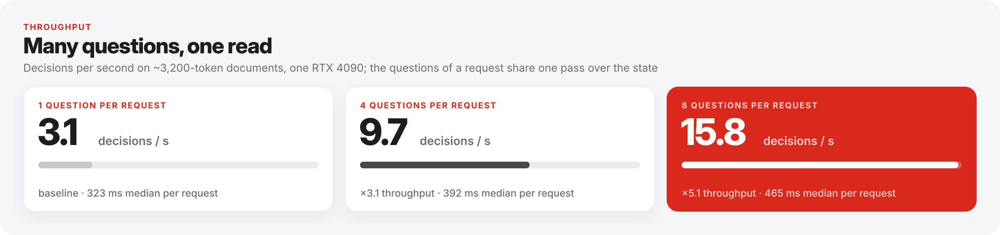

<h1 align="center"> votum</h1>

<p align="center"><b>The Votum decision models: PyTorch reference, vLLM server, training and data recipe.</b></p>

<p align="center"><sub>Independent project, built on Apertus-1.5-8B (Swiss AI Initiative) · not affiliated</sub></p>

<p align="center">
  <a href="https://huggingface.co/{{ORG}}/Votum-8B"></a>
  <a href="https://huggingface.co/datasets/{{ORG}}/Votum-Pool"></a>
  <a href="https://huggingface.co/swiss-ai/Apertus-v1.5-8B"></a>
  
  
</p>

<p align="center">
  <a href="#quickstart">Quickstart</a> ·
  <a href="#serve">Serve</a> ·
  <a href="#how-it-works">How it works</a> ·
  <a href="#reproduce">Reproduce</a> ·
  <a href="https://huggingface.co/{{ORG}}/Votum-8B">Model card</a>
</p>

**Votum** turns  [Apertus-1.5-8B](https://huggingface.co/swiss-ai/Apertus-v1.5-8B)
into a decision model. Give it a state, a question and the options; it returns a probability for every option in one
forward pass. Nothing is generated, so a decision costs one prompt read (about 50 ms on an RTX 4090) and the
probabilities always sum to one.

<picture><source media="(prefers-color-scheme: dark)" srcset="assets/architecture_dark.png"></picture>

<picture><source media="(prefers-color-scheme: dark)" srcset="assets/examples_dark.png"></picture>

## Quickstart

```bash
pip install "votum @ git+https://github.com/{{ORG}}/votum"
```

Accept the Apertus Acceptable Use Policy on [{{ORG}}/Votum-8B](https://huggingface.co/{{ORG}}/Votum-8B) and run
`huggingface-cli login`. The repository holds everything the model needs.

```python
from votum import Votum

vm = Votum.from_pretrained("{{ORG}}/Votum-8B")     # ~16 GB in bf16; a 24 GB GPU is plenty

out = vm.decide({
    "state": {"from": "anna@example.com", "subject": "Invoice 4411", "body": "I was charged twice in October."},
    "questions": {
        "team":   {"type": "choice", "instructions": "Which team handles this?",
                   "criteria": {"billing": "Billing and payments", "tech": "Technical support", "sales": "Sales"}},
        "refund": {"type": "noul",   "instructions": "Does the customer ask for money back?"},
        "tone":   {"type": "score",  "instructions": "How upset is the customer?",
                   "criteria": ["calm", "annoyed", "angry"]},
    },
})
out["answers"]["team"]     # {"type": "choice", "choice": "billing", "confidence": ..., "probabilities": {...}}
```

Three question types: **`choice`** (the choice, its confidence and every option's probability), **`noul`** (the
probability of yes) and **`score`** (the expected level and each level's probability). A request takes up to 8
questions about one state; they are answered together, in one pass over the state.

## Serve

```bash
pip install "votum[vllm] @ git+https://github.com/{{ORG}}/votum"
VOTUM_API_KEY=... votum serve --model {{ORG}}/Votum-8B --host 0.0.0.0 --port 8011
```

`POST /v1/systemone` takes the same request as `vm.decide` and returns the same answers. Concurrent requests are
batched, and a short request takes about 30 ms on an RTX 4090. Start-up takes about a minute: the server compiles its
attention kernels for every shape class first, so no request pays for one.

One decision costs one read. Median latency per answer on one RTX 4090 with the same Apertus-8B backbone, on
256-request samples of OpenDecisions, one question per request; the alternatives generate text:

| Mode | Median latency | Tokens written | Requests/s (batched) |
|---|---:|---:|---:|
| **Votum: a decision** | **39 ms** | **0** | **23.5** |
| JSON: the choice (grammar-constrained) | 206 ms | 8 | 21.0 |
| JSON: choice and probabilities (grammar-constrained) | 1.1 s | 54 | 10.9 |
| Reason first, then the JSON | 10.5 s | 370 | 1.9 |

<sub>Decision row: these merged weights on vLLM 0.33. Generative rows: vLLM 0.12, a different 256-row sample; the last
row batches 64 requests and times 10. Latency is one request at a time, median of 50.</sub>

The questions of a request share one pass over the state, so more questions per request means more decisions per
second:

<picture><source media="(prefers-color-scheme: dark)" srcset="assets/state_once_dark.png"></picture>

<details>
<summary><b>Server settings</b></summary>

All through the environment:

| Variable | Default | Effect |
|---|---|---|
| `VOTUM_API_KEY` | unset | when set, requests need `Authorization: Bearer <key>` |
| `VOTUM_PREFIX_CACHE_MB` | 512 | exact cache of header blocks across requests |
| `VOTUM_STATE_CACHE_MB` | 0 (off) | exact cache of state blocks across requests |
| `VOTUM_HEADER_CHUNK` | 0 (off) | `1` splits requests of more than 8 questions into separate headers (not measured on labelled data) |

vLLM's own prefix cache and chunked prefill stay off: a bidirectional layer needs the whole prompt at once, so the
exact block caches above take their place.

</details>

## How it works

The diagram at the top shows the path of a request. The parts:

- **One prompt per request.** A header lists every question of the request, then comes the state, then each question
  with its options. The model was trained in this layout.
- **Block mask.** The header never reads the state, the state never reads a question, and options never see each
  other. The header-plus-state block is therefore identical for all questions and computed once.
- **Shared positions.** Every option starts at the same position id, so option order carries no positional signal.
- **Pointer head.** Each option is scored from the final hidden state at its end token,
  score = ⟨q₀, W_o · LN(h)⟩ / 16; the probabilities are a softmax over those scores.
- **Bidirectional layers** 3, 7, …, 31; the other 24 stay causal.

<details>
<summary><b>Weights and implementation</b></summary>

- The LoRA adapter is merged into the Apertus weights (bf16), so the checkpoint loads like any 8B model. The exact
  unmerged form is in the repo's `adapter/` folder (`Votum.from_pretrained(repo, exact=True)` or `votum build --exact`);
  the two agree on about 98 % of answers. `votum build` rebuilds the shipped weights byte for byte from the official
  Apertus snapshot and the adapter.
- The attention layout is rules, not weights. They live in `votum_config.json`; `src/votum/modeling.py` applies them as
  dense SDPA masks, `src/votum/vllm/isolate.py` as FlexAttention with packing, and `tests/test_masks.py` proves the two
  equal.
- The PyTorch reference runs one pass per question. The server packs a request's questions into one prompt, each at
  the positions of its own single-question prompt, and gives the same answers.

</details>

## Repository

```
src/votum/          prompt rendering · reference model (PyTorch) · request format · checkpoint builder · CLI
src/votum/vllm/     vLLM 0.33 model · attention layout and cache · client · HTTP server
training/           the trainer that produced Votum-8B, with the exact command
data/               source list with licences · cleaning and PII pipeline
scripts/            export a checkpoint to the Hub layout · smoke fixture · README graphics
tests/              masks, positions, renderer, request format (CPU) · end-to-end smoke test (GPU)
```

## Reproduce

1. **Data:** the cleaned pool is [{{ORG}}/Votum-Pool](https://huggingface.co/datasets/{{ORG}}/Votum-Pool); the pipeline
   that builds it is in `data/`.
2. **Training:** `training/README.md` has the exact command. One 96 GB GPU, about 7 hours.
   **Fine-tuning on your own data** is covered there too: `prepare_data.py`, `finetune.py` (from the released adapter;
   a 24 GB card trains rows up to 3,072 tokens), `export_hf.py` and `calibrate.py`.
3. **Export:** `python scripts/export_hf.py --ckpt <run>/ckpt_600 --out <dir>` reproduces the published repository
   byte for byte.

The released checkpoint was trained before the pool was cleaned; its known training-data issues are on the model card,
and a re-train on the published pool is planned.

## Tests

```bash
pip install -e ".[test]"
pytest                                                     # CPU
VOTUM_TOKENIZER=<dir with the Apertus tokenizer> pytest    # + renderer
VOTUM_REPO={{ORG}}/Votum-8B pytest -m gpu                   # + end-to-end smoke test
```

## License

Apache-2.0 (`LICENSE`, `NOTICE`). The base model carries the
[Apertus Acceptable Use Policy](https://huggingface.co/swiss-ai/Apertus-v1.5-8B/blob/main/USAGE_POLICY.pdf), which
binds anyone who uses Votum. Votum is an independent project, not affiliated with or endorsed by the Swiss AI
Initiative.
