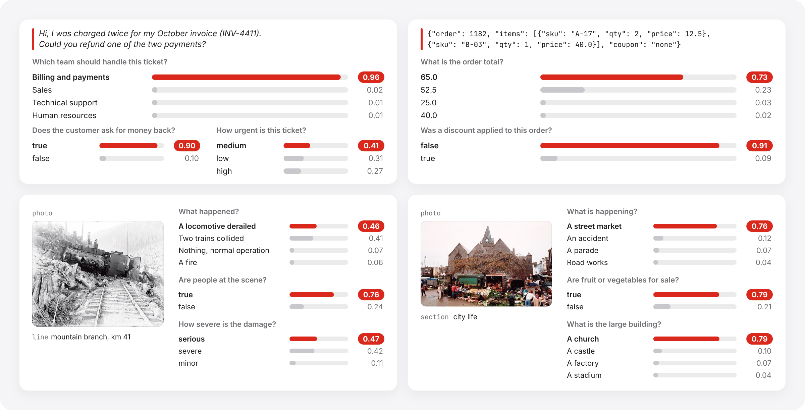

<h1 align="center"> votum</h1>

<p align="center"><b>The Votum decision models: PyTorch reference, vLLM server, training and data recipe.</b></p>

<p align="center"><sub>Independent project, built on Apertus-1.5-8B (Swiss AI Initiative) · not affiliated</sub></p>

<p align="center">
  <a href="https://huggingface.co/{{ORG}}/Votum-8B"></a>
  <a href="https://huggingface.co/datasets/{{ORG}}/Votum-Pool"></a>
  <a href="https://huggingface.co/swiss-ai/Apertus-v1.5-8B"></a>
  
  
</p>

<p align="center">
  <a href="#quickstart">Quickstart</a> ·
  <a href="#serve">Serve</a> ·
  <a href="#how-it-works">How it works</a> ·
  <a href="#reproduce">Reproduce and fine-tune</a> ·
  <a href="https://huggingface.co/{{ORG}}/Votum-8B">Model card</a>
</p>

**Votum** turns  [Apertus-1.5-8B](https://huggingface.co/swiss-ai/Apertus-v1.5-8B)
into a decision model. Give it a state, a question and the options; it returns a probability for every option in one
forward pass. Nothing is generated, so a decision costs one prompt read (about 40 ms on an RTX 4090) and the
probabilities always sum to one.

<picture><source media="(prefers-color-scheme: dark)" srcset="assets/architecture_dark.png"></picture>

<picture><source media="(prefers-color-scheme: dark)" srcset="assets/examples_dark.png"></picture>

## Quickstart

```bash
pip install "votum @ git+https://github.com/{{ORG}}/votum"            # PyTorch reference path
pip install "votum[vllm] @ git+https://github.com/{{ORG}}/votum"      # + the vLLM server (install this one directly if you will serve)
```

You need Python 3.11 or newer and a CUDA GPU with 24 GB (16 GB is enough for the [FP8 variant](#serve)). It also runs
on a CPU, slowly.

Before the first download, accept the Apertus Acceptable Use Policy on
[{{ORG}}/Votum-8B](https://huggingface.co/{{ORG}}/Votum-8B) and run `hf auth login`. That repository holds everything
the model needs; there is no base model to fetch.

```python
from votum import Votum

vm = Votum.from_pretrained("{{ORG}}/Votum-8B")     # ~16 GB in bf16; a 24 GB GPU is plenty

out = vm.decide({
    "state": {"from": "anna@example.com", "subject": "Invoice 4411", "body": "I was charged twice in October."},
    "questions": {
        "team":   {"type": "choice", "instructions": "Which team handles this?",
                   "criteria": {"billing": "Billing and payments", "tech": "Technical support", "sales": "Sales"}},
        "refund": {"type": "noul",   "instructions": "Does the customer ask for money back?"},
        "tone":   {"type": "score",  "instructions": "How upset is the customer?",
                   "criteria": ["calm", "annoyed", "angry"]},
    },
})
out["answers"]["team"]     # {"type": "choice", "choice": "billing", "confidence": ..., "probabilities": {...}}
```

A request asks up to 8 questions about one state, and they are answered together in one pass over that state. There
are three kinds of question, each with its own answer:

| Question (`questions.<id>`) | Answer (`answers.<id>`) |
|---|---|
| `{"type": "choice", "instructions": str, "criteria": {option_id: text} or [option_id, ...]}` (2 or more options) | `{"type": "choice", "choice": option_id, "confidence": p of the choice, "probabilities": {option_id: p}}` |
| `{"type": "noul", "instructions": str, "criteria": {"true": text, "false": text}}` (criteria optional) | `{"type": "noul", "noul": p(yes)}` |
| `{"type": "score", "instructions": str, "criteria": [level texts, low to high]}` | `{"type": "score", "score": expected level index (float), "confidence": p of the most likely level, "legend": {"0": text, ...}, "probabilities": {"0": p, ...}}` |

The `state` is a string or any JSON object. A question whose prompt is longer than 8,192 tokens is refused, not
truncated: an error in Python, HTTP 413 on the server (a malformed request is 400). The response also carries
`usage.output_tokens: 0`, because nothing is generated.

## Serve

```bash
pip install "votum[vllm] @ git+https://github.com/{{ORG}}/votum"
VOTUM_API_KEY=... votum serve --model {{ORG}}/Votum-8B --host 0.0.0.0 --port 8011
```

`POST /v1/systemone` takes the same request as `vm.decide` and returns the same answers. Concurrent requests are
batched. Start-up takes about a minute.

**On a 16 GB card**, serve [{{ORG}}/Votum-8B-FP8](https://huggingface.co/{{ORG}}/Votum-8B-FP8) instead: the same model
in a little over half the memory (9.2 GB), which gives the same answer 96–99 % of the time. It runs on the server only, not in the Python
quickstart above.

**How fast is it?** A decision costs one read of the prompt. Here it is next to asking the same backbone to write its
answer, on one RTX 4090:

| Mode | Median latency | Tokens written | Requests/s (batched) |
|---|---:|---:|---:|
| **Votum: a decision** | **39 ms** | **0** | **23.5** |
| JSON: the choice (structured output) | 206 ms | 8 | 21.0 |
| JSON: choice and probabilities (structured output) | 1.1 s | 54 | 10.9 |
| Reason first, then the JSON | 10.5 s | 370 | 1.9 |

Questions about the same state share one pass over it, so asking several at once is cheaper than asking them one by
one: on long documents the server makes 3.1 decisions per second with one question per request, and 15.8 with eight.
The [model card](https://huggingface.co/{{ORG}}/Votum-8B#performance) has the full measurements.

<details>
<summary><b>Server settings</b></summary>

All settings are environment variables:

| Variable | Default | Effect |
|---|---|---|
| `VOTUM_API_KEY` | unset | when set, requests need `Authorization: Bearer <key>` |
| `VOTUM_PREFIX_CACHE_MB` | 512 | exact cache of header blocks across requests |
| `VOTUM_STATE_CACHE_MB` | 0 (off) | exact cache of state blocks across requests |
| `VOTUM_MAX_BODY_MB` | 8 | largest request body; beyond it HTTP 413 |
| `VOTUM_MAX_QUESTIONS` | 64 | questions per request; beyond it HTTP 400 |
| `VOTUM_MAX_OPTIONS` | 2000 | options per question; beyond it HTTP 400 |
| `VOTUM_MAX_QUEUE` | 4096 | questions waiting for the GPU; beyond it HTTP 503 |
| `VOTUM_HEADER_CHUNK` | 0 (off) | `1` splits requests of more than 8 questions into separate headers (not measured on labelled data) |

vLLM's own prefix cache and chunked prefill stay off: a bidirectional layer needs the whole prompt at once, so the
exact block caches above take their place.

</details>

## How it works

The diagram at the top follows one request through the model.

**One prompt.** A request becomes a single prompt: a header that lists its questions, then the state, then each
question with its options. The model was trained on this layout.

**Who reads whom.** An attention mask keeps the parts apart. The header never reads the state, the state never reads
a question, and the options never see each other. Because of that, the header and the state are the same for every
question of the request and are computed once. Every option also starts at the same position, so the order in which
you list the options carries no signal.

**One score per option.** Each option ends with an end token. A small head reads the model's final state there and
turns it into a score; the probabilities are a softmax over the scores of a question's options.

**Limits.** A question's prompt can hold 8,192 tokens, which is how far the model was trained and tested. Any number
of options fits within that, though accuracy falls as their number grows. A request can ask up to 8 questions. The
model card's Limitations section has the details.

<details>
<summary><b>Weights and implementation</b></summary>

- **Merged weights.** The LoRA adapter is folded into the Apertus weights (bf16), so the checkpoint loads like any 8B
  model. The unmerged adapter is in the model repo's `adapter/` folder; load it with
  `Votum.from_pretrained(repo, exact=True)` or build a serving checkpoint with `votum build --exact`. The two forms
  agree on about 98 % of answers. `votum build` rebuilds the shipped weights byte for byte from the official Apertus
  snapshot and the adapter.
- **Layers and head.** Eight of the 32 layers (3, 7, …, 31) attend in both directions; the other 24 stay causal. The
  head scores an option as ⟨q₀, W_o · LN(h)⟩ / 16, where h is the final hidden state at the option's end token.
- **The attention layout is rules, not weights.** The rules live in `votum_config.json`. `src/votum/modeling.py`
  applies them as dense masks and `src/votum/vllm/isolate.py` as FlexAttention; `tests/test_masks.py` checks that the
  two produce the same mask and positions for single-question prompts.
- **Two paths.** The PyTorch reference runs one pass per question. The server packs a request's questions into one
  prompt, each at the positions it would have alone; the two agree on 97 to 99 % of answers (parity numbers are on the
  model card).

</details>

## Repository

```
src/votum/          prompt rendering · reference model (PyTorch) · request format · checkpoint builder · CLI
src/votum/vllm/     vLLM 0.33 model · attention layout and cache · client · HTTP server
training/           fine-tuning kit (prepare_data · finetune · calibrate) and the trainer that produced Votum-8B
data/               source list with licences · cleaning and PII pipeline
scripts/            export a checkpoint to the Hub layout · FP8 quantization · smoke fixture · README graphics
tests/              masks, positions, renderer, request format (CPU) · end-to-end smoke test (GPU)
```

## Reproduce

**Fine-tune on your own data.** [`training/README.md`](training/README.md) is a step-by-step guide: prepare your rows,
train from the released checkpoint, export, calibrate. A 24 GB card trains rows up to 3,072 tokens, or 2,048 if it
also drives a display.

**Reproduce the release.**

1. **Data.** The cleaned pool is [{{ORG}}/Votum-Pool](https://huggingface.co/datasets/{{ORG}}/Votum-Pool); the pipeline
   that builds it is in `data/`.
2. **Training.** `training/README.md` has the exact command of the released run: one 96 GB GPU, about 7 hours.
3. **Export.** `python scripts/export_hf.py --ckpt <run>/ckpt_600 --out <dir>` reproduces the published model
   repository byte for byte.

The released checkpoint was trained before the pool was cleaned. Its known training-data issues are listed on the
model card, and a re-train on the published pool is planned.

## Tests

```bash
pip install -e ".[test]"
pytest                                                     # CPU
VOTUM_TOKENIZER=<dir with the Apertus tokenizer> pytest    # + renderer
VOTUM_REPO={{ORG}}/Votum-8B pytest -m gpu                   # + end-to-end smoke test
```

## License

Apache-2.0 (`LICENSE`, `NOTICE`). The base model carries the
[Apertus Acceptable Use Policy](https://github.com/swiss-ai/apertus-legal/blob/main/apertus_1.5/USAGE_POLICY.pdf), which
binds anyone who uses Votum. Votum is an independent project, not affiliated with or endorsed by the Swiss AI
Initiative.
