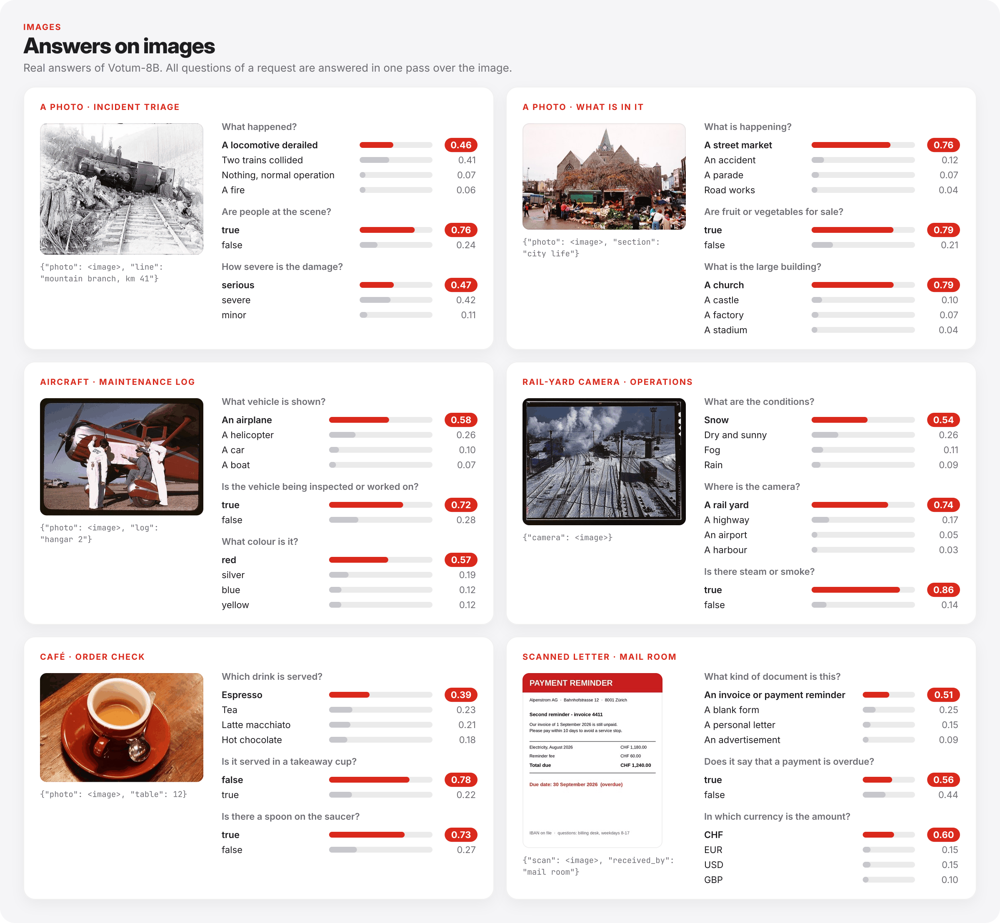

# Images in a request

The state of a request can hold images. Put one anywhere in it as `{"image": ...}`:

```python
request = {
    "state": {"photo": {"image": "wreck.jpg"}, "line": "mountain branch, km 41"},
    "questions": {
        "incident": {
            "type": "choice",
            "instructions": "What happened?",
            "criteria": {
                "derailment": "A locomotive derailed",
                "collision": "Two trains collided",
                "fire": "A fire",
                "none": "Nothing, normal operation",
            },
        },
        "people": {"type": "noul", "instructions": "Are people at the scene?"},
        "severity": {
            "type": "score",
            "instructions": "How severe is the damage?",
            "criteria": ["minor", "serious", "severe"],
        },
    },
}

out = vm.decide(request)
```

<picture><source media="(prefers-color-scheme: dark)" srcset="../assets/examples_vision_dark.png"></picture>

This works with the released model as it is. **Votum-8B was never trained on images, so take it as a preview.**

## Setting up

Images need two more packages:

```bash
pip install "votum[vision] @ git+https://github.com/hypathia/votum"
```

The first image you send downloads the Apertus image tokenizer (0.9 GB) from the
[Apertus repository](https://huggingface.co/swiss-ai/Apertus-v1.5-8B), whose usage policy you accept there as well.

| | Python | Server |
|---|---|---|
| **An image can be** | a file path, bytes, a PIL image or base64 | base64 or a data URL (`"data:image/png;base64,..."`); the server never opens files or URLs named in a request |
| **Images per request** | | at most 8 |
| **Largest image** | `vm.decide(request, max_image_codes=...)` | `--max-image-codes` |
| **When the tokenizer loads** | at the first image; `vision="eager"` loads it at start-up, `vision="off"` refuses images | the same, with `--vision eager` or `--vision off` |
| **Memory** | the tokenizer adds about 2 GB of GPU memory | `--image-device cpu` keeps it off the GPU, at a few seconds per image |

## How it works

Apertus 1.5 reads an image as tokens of its own vocabulary, one token per 16 × 16 pixel patch, and Votum keeps that
vocabulary. An image is scaled to at most 1,024 tokens, about 512 × 512 pixels. On the server, all questions of a
request share one pass over the image: the three questions above take one prompt of about 1,200 tokens and about
130 ms on an RTX 4090.

## How well it works

Accuracy on held-out test sets, next to the Apertus model Votum is built on, which answers with the letter of an
option:

| Test set (chance) | Votum-8B | Votum-8B-FP8 | Apertus-1.5-8B |
|---|---:|---:|---:|
| A-OKVQA: questions about photos, 4 options (25 %) | 68.3 % | 68.5 % | 76.0 % |
| POPE: is this object in the photo? (50 %) | 80.4 % | 79.4 % | 82.8 % |
| CIFAR-10: what does the photo show? 10 classes (10 %) | 73.1 % | 73.5 % | 71.4 % |
| RVL-CDIP: which of 16 document types? (6 %) | 25.5 % | | 29.5 % |

Everyday photos work well. Reading the text in a scanned document does not yet: the payment reminder in the figure is
classified correctly, but with little confidence. The figure shows 6 of the 12 image requests written for this page;
across all 12, 29 of the 36 answers are right.

In a test run, 1.5 hours of fine-tuning on images mixed with text raised A-OKVQA to 79 %, CIFAR-10 to 83 % and the
document types to 64 %, with the text benchmarks unchanged. Image support in the training kit is not released yet.
