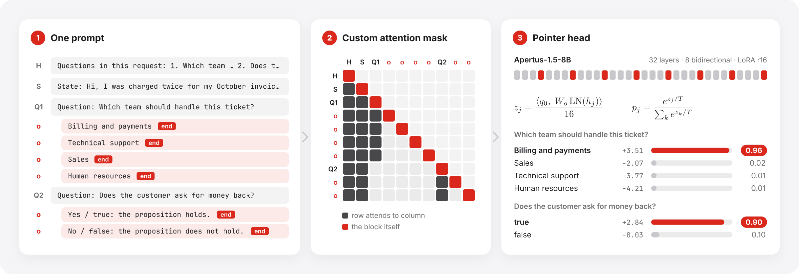

# How Votum works inside

For readers who want to change the model, check it or reproduce it. To use it, the [README](../README.md) is enough.

<picture><source media="(prefers-color-scheme: dark)" srcset="../assets/architecture_dark.png"></picture>

## One request

**One prompt.** A request becomes a single prompt: a header that lists its questions, then the state, then each
question with its options. The model was trained on this layout; the package builds it.

**Who reads whom.** An attention mask defines which blocks of the prompt attend to which. The header never reads
the state, the state never reads a question, and the options never see each other. Because of that, the header and
the state are the same for every question of the request and are computed once. Every option also starts at the same position,
so the order of the options carries no signal.

**One score per option.** Each option ends with an end token. The pointer head turns the final hidden state at that
token into a score, and a softmax over the scores of a question's options gives the probabilities.

## Weights

Votum is a LoRA adapter and a pointer head on top of Apertus-1.5-8B.

- **Merged weights.** The published checkpoint has the adapter already merged into the Apertus weights (bf16), so it
  is one download and loads like any 8B model.
- **The adapter on its own** is in the model repo's `adapter/` folder. Load it with
  `Votum.from_pretrained(repo, exact=True)`, or build a serving checkpoint with `votum build --exact`. The two forms
  agree on about 98 % of answers.
- **Rebuilding.** `votum build` rebuilds the shipped weights byte for byte from the official Apertus snapshot and the
  adapter.
- **FP8.** `votum quantize --model <dir> --out <dir>` stores most weights in 8 bits (about a minute, no GPU needed);
  see the [Votum-8B-FP8 card](https://huggingface.co/votum-ai/Votum-8B-FP8) for what that changes.

## Implementation

- **Layers and head.** Eight of the 32 layers (3, 7, …, 31) attend in both directions; the other 24 stay causal. The
  head scores an option as ⟨q₀, W_o · LN(h)⟩ / 16, where h is the final hidden state at the option's end token.
- **The attention layout is rules, not weights.** The rules live in `votum_config.json`. `src/votum/modeling.py`
  applies them as dense masks and `src/votum/vllm/isolate.py` as FlexAttention; `tests/test_masks.py` checks that the
  two produce the same mask and positions for single-question prompts.
- **Two paths.** The PyTorch reference runs one pass per question. The server packs a request's questions into one
  prompt, each at the positions it would have alone; the two agree on 97 to 99 % of answers (the numbers are on the
  [model card](https://huggingface.co/votum-ai/Votum-8B#speed)).
- **Load it with `votum`.** Plain transformers or plain vLLM would run the network without these rules and without
  the head, and give wrong answers.

The exact definition of every part is in the model card's
[How it works](https://huggingface.co/votum-ai/Votum-8B#how-it-works) section.

## Repository

```
src/votum/          the model in PyTorch · prompt builder · request format · images · checkpoint builder · FP8 · command line
src/votum/vllm/     the vLLM server: model, attention rules and caches, client, HTTP API
training/           fine-tuning kit (prepare_data · finetune · calibrate) and the trainer that produced Votum-8B
data/               source list with licences · cleaning and personal-data removal
scripts/            export a checkpoint to the Hub layout · smoke fixture · README graphics
tests/              attention rules, prompt builder, request format (CPU) · end-to-end test (GPU)
```

## Tests

```bash
pip install -e ".[test]"
pytest                                                     # CPU
VOTUM_TOKENIZER=<dir with the Apertus tokenizer> pytest    # + renderer
VOTUM_REPO=votum-ai/Votum-8B pytest -m gpu                 # + end-to-end smoke test
```

## Reproducing the release

[`training/README.md`](../training/README.md) has the exact command of the released training run, which took about 7
hours on one 96 GB GPU. The training data is published as
[votum-ai/Votum-Pool](https://huggingface.co/datasets/votum-ai/Votum-Pool), and the pipeline that builds it is in
`data/`. After training, `python scripts/export_hf.py --ckpt <run>/ckpt_600 --out <dir>` reproduces the published
model repository byte for byte.

The released model was trained before the pool was cleaned. Its known training-data issues are listed on the
[model card](https://huggingface.co/votum-ai/Votum-8B#training), and a re-train on the published pool is planned.
